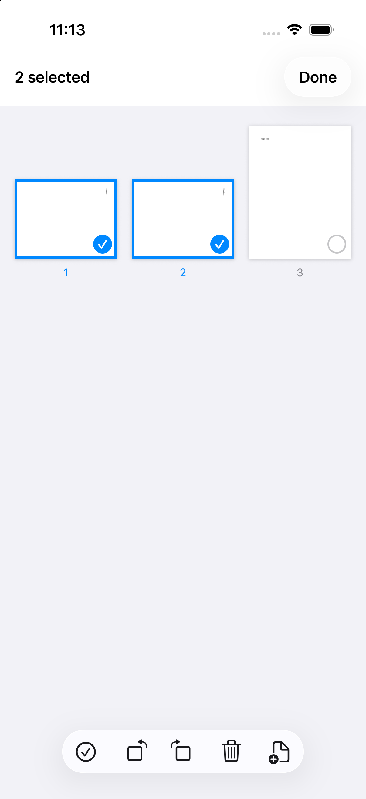
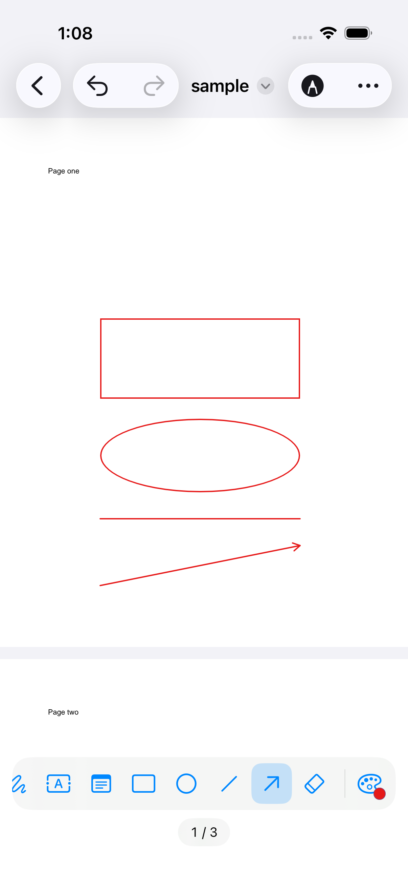
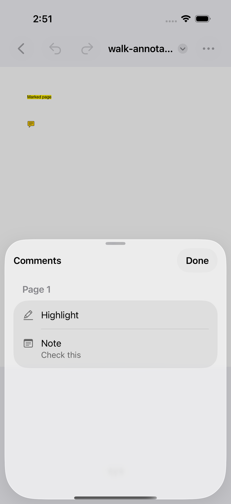
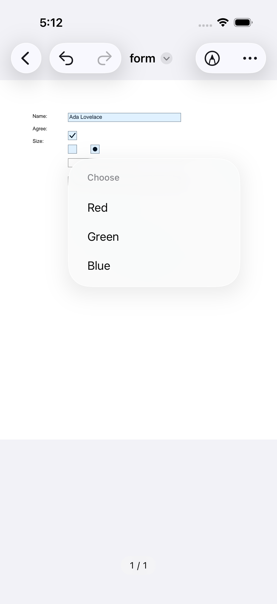
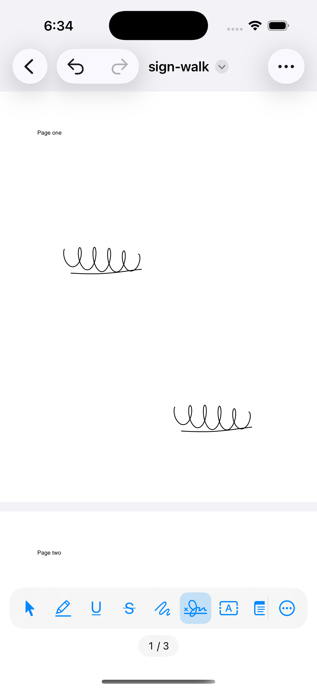

# EditinPDF

A free, native iOS app for reading, organizing and annotating PDFs — fully offline, no account, no telemetry.

**Status: pre-release, in TestFlight (0.2.0).** The viewer, page organizing, mark-up, form filling and signing
work. The Licenses screen and the App Store release (M4) are still to come. Nothing is on the App Store yet.

[](https://github.com/smartinchow/EditinPDF/actions/workflows/ci.yml)

EditinPDF is based on [PdfCraft](https://github.com/storytold/pdfcraft) by the ArtCraft team, an open-source
PDF engine written in pure Rust. EditinPDF is an independent project and is not affiliated with or endorsed by
the ArtCraft team or Adobe Inc.

<table>
  <tr>
    <td></td>
    <td></td>
    <td></td>
    <td></td>
    <td></td>
  </tr>
  <tr>
    <td align="center">Organize pages</td>
    <td align="center">Shapes and arrows</td>
    <td align="center">Comments list</td>
    <td align="center">Fill in forms</td>
    <td align="center">Sign</td>
  </tr>
</table>

The screenshots show sample documents made for testing. More are in [docs/screenshots](docs/screenshots/).

## What works today

On iPhone and iPad (iOS 17 and later; tested on the iOS 26.5 and 27.1 simulators, including iPhone Duo):

- **Open** a PDF from the Files document browser. A password-protected file asks for its password; a file that
  is not a readable PDF says so and closes.
- **Read**: scroll through the pages and pinch to zoom, up to 8x. Pages are drawn in tiles, so deep zoom stays
  sharp, and the page indicator shows where you are.
- **Thumbnails**: a sheet of page thumbnails; tap one to jump to that page.
- **Search** for text: hits are highlighted on the pages, and you can step through them or pick one from the list.
- **Select and copy** text: long-press a word, drag the handles to extend the selection, then Copy.
- **Organize pages**: select several pages, drag to reorder, rotate, delete, insert a blank page, insert the
  pages of another PDF, and extract pages to a new PDF to share or save.
- **Undo and redo** every change (the last 100); changes **save automatically** back to the original file, as an
  incremental update that keeps the original bytes (a damaged file is the exception: see Known issues). A new
  blank document can be started from the file browser.
- **Mark up**: a Markup mode with a tool palette (a bar at the bottom on iPhone, a side palette on iPad). Each
  tool remembers its colour and line width.
  - **Text markup**: highlight, underline and strikethrough over text you drag across.
  - **Draw** with a finger or an Apple Pencil.
  - **Shapes and arrows**: rectangle, oval, line and arrow, with an optional fill for rectangles and ovals.
  - **Text boxes** and **notes**: type on the page, or leave a sticky note.
  - **Select, move, edit and delete** marks and notes. The **eraser** deletes whole marks it touches.
  - A **Comments list** of the marks and notes in the file, by page. Tap one to jump to it; swipe to delete it.
- **Fill in forms**: text fields, check boxes, radio buttons, and lists (drop-down and list boxes).
- **Sign**: draw your signature once, then place it on any page, as often as you need. It is a drawn mark on the
  page, not a digital signature. The saved signature is stored only on your device, in the app's own folder with
  file protection, and is excluded from backups.
- **Save a Copy** from the More menu: the document with all its changes, saved in the folder and under the name you
  choose (the name offered is the document's, with " copy"). The document you are working on stays open. A copy of
  a password-protected document keeps its password.
- **Send Feedback** from the More menu: an email to info@consultin.ai, ready to write, that names the app's
  version, the system and the device model, and nothing of your documents. Your own mail app sends it (where none is
  set up, the app shows the address to copy); EditinPDF itself sends nothing.

Still to come: the Licenses screen and the App Store release (M4). The privacy manifest ships already: no
tracking and no data collected.

## Known issues

- iOS 17 and 18 are untested (Xcode 27 offers no simulator runtime for them).
- Apple Pencil has only been tested in the simulator, which sends finger touches. Drawing and signing use
  PencilKit's any-input policy and the other tools use ordinary drags, so a Pencil should work, but it has not
  been tried on a device.
- Text boxes are not offered on a page that has been turned (rotated), because the engine draws their text
  sideways there. Turn the page back first. The other tools are offered on turned pages.
- Pages extracted from a password-protected PDF are written without the password. The Organize screen says so.
- Forms that compute values with their own scripts (totals, formatting) are not recalculated: EditinPDF doesn't
  run scripts in documents. The usual built-in sums and number and date formats still work.
- A damaged file is written out in full the first time it changes, rather than keeping its original bytes and
  adding the changes after them. A damaged file that is digitally signed can't be changed at all, since that would
  break its signatures; the app says so.
- Undo goes back at most 100 changes.
- Text outside the Latin alphabet (Greek, Cyrillic, Chinese, Japanese, Korean, emoji and the like) typed in a text
  box shows on the page as "?": the engine draws text boxes in a standard font that has only Western European
  letters. The text itself is kept as typed (the Comments list shows it). A form field is drawn the same way,
  unless the form brings a font for such text, as many Japanese forms do (even then, not emoji); its value is kept
  as typed, and the file asks other PDF apps to draw the field again.
- The iOS 27 SDK marks `ReferenceFileDocument` and the `DocumentGroup` initializer the app uses as deprecated, in
  favour of a `Document` protocol that needs iOS 27. The app supports iOS 17, so it keeps them. The build prints
  no warning for this today; the switch comes when the minimum moves to iOS 27.

## Feedback and support

Send feedback from the app's More menu, or email info@consultin.ai. Bug reports and pull requests are welcome on GitHub.

## Building

Requirements: macOS with Xcode 27 (iOS 27 SDK), [Homebrew](https://brew.sh).

```sh
git clone --recurse-submodules https://github.com/smartinchow/EditinPDF
cd EditinPDF
make setup          # rustup + iOS targets, cmake, xcodegen, and the engine submodule
make xcframework    # builds the Rust core for device, simulator and macOS, generates the Swift bindings
make ios            # generates EditinPDF.xcodeproj and builds for the simulator
```

Then open `ios/EditinPDF.xcodeproj` in Xcode and run. The XCFramework and the generated Swift bindings are build
output, not committed: run `make xcframework` again after changing anything in `core/` or `upstream/`.

`make help` lists the targets:

| Target | What it does |
|---|---|
| `make setup` | Installs rustup, cmake and XcodeGen with Homebrew, selects stable Rust with the iOS targets, fetches the engine submodule |
| `make core` | Builds the Rust core for the Mac (a fast check) |
| `make core-test` | Runs the Rust test suite of the bridge |
| `make lint` | `cargo fmt --check` and clippy with warnings denied |
| `make xcframework` | Builds the Rust core for device, simulator and macOS, generates the Swift bindings, assembles the XCFramework |
| `make project` | Generates `ios/EditinPDF.xcodeproj` from `ios/project.yml` |
| `make ios` | Builds the app for the simulator |
| `make test` | `cargo test`, the Swift package's tests, then the app's unit and UI tests on a simulator: the first iPhone on the newest iOS runtime installed (pin one with `SIM_UDID=<udid>`). The result bundle is `ios/build/EditinPDF.xcresult` |
| `make release-check` | Builds Release for the simulator and fails if the app contains any PDF (the UI tests' sample documents are Debug-only) |
| `make update-upstream TAG=v0.8.0` | Moves the engine to a newer PdfCraft release and re-runs the bridge tests |
| `make clean` | Removes the build output |
| `make notices` | Not implemented until milestone M4: prints a message and exits with an error. `docs/THIRD-PARTY-NOTICES.md` is a stub until then |

The Xcode targets print only warnings and errors (`-quiet`); `make test XCFLAGS=` prints everything.

## Project layout

The Rust core in `core/` wraps the engine and exposes a typed API to Swift through
[UniFFI](https://mozilla.github.io/uniffi-rs/); the SwiftUI app in `ios/` (iPhone and iPad, iOS 17+) links it as an
XCFramework, through a Swift package.

```
core/                    Rust workspace
  editinpdf-core/        the bridge crate: wraps the engine, exposes a typed API to Swift through UniFFI
  uniffi-bindgen/        the binding generator, run by core/scripts/build-xcframework.sh
  scripts/               build-xcframework.sh: device, simulator and macOS libraries -> Swift bindings -> XCFramework
  vendor/num_threads/    a patched copy of one dependency that does not compile for iOS (docs/adr/0001)
ios/
  project.yml            XcodeGen spec; EditinPDF.xcodeproj is generated from it and committed
  Config/Base.xcconfig   bundle identifier and version numbers
  EditinPDF/             the SwiftUI app, in folders by feature:
    App/                   the app entry and the document scene
    Document/              the document model, the edit queue and saving (docs/adr/0002)
    Viewer/                the tiled page view, zoom and the screen around it
    Thumbnails/ Search/ Selection/    thumbnails, search, select and copy text
    Organize/              the page grid: reorder, rotate, delete, insert, extract
    Markup/                the tool palette, drawing, shapes, text boxes, notes, select and erase, the Comments list
    Forms/                 filling in form fields
    Sign/                  the drawn signature and where it is kept
    Open/ Support/         the password prompt; user-visible strings and diagnostics
  EditinPDFCore/         Swift package around the XCFramework (the bindings and the XCFramework are build output)
  EditinPDFTests/        unit tests
  EditinPDFUITests/      UI tests, and the sample PDFs only Debug builds bundle
scripts/                 helpers shared by make and CI: pick-simulator.sh, check-release-bundle.sh
upstream/pdfcraft/       the PdfCraft engine, a git submodule pinned to a release tag, never modified here
docs/                    design spec, plans and architecture decision records (ADRs)
.github/workflows/       CI
```

Design notes live in [docs/superpowers/specs](docs/superpowers/specs/). The build spike and its numbers are in
[docs/adr/0001-ios-build-spike.md](docs/adr/0001-ios-build-spike.md); how edits, undo and saving fit together is in
[docs/adr/0002-editing.md](docs/adr/0002-editing.md).

## Continuous integration

`.github/workflows/ci.yml` runs on every push to `main` and every pull request, on GitHub's `xcode-27` macOS
image (Xcode 27 is in public preview there and not on `macos-latest` yet). It checks Rust formatting, clippy and
the Rust tests; builds the XCFramework; runs the Swift package tests; checks that the committed Xcode project is
what `project.yml` generates; runs the app's unit and UI tests on a simulator chosen from what the runner has; and
builds Release to check that no PDF ships in the app. `make lint test release-check` runs the same checks on
your Mac; after `make project`, `git status` shows whether the committed Xcode project was out of date.

## Contributing, and updating the engine

Run `make lint test release-check` before sending a change. Two files are generated from others, so change the
source and regenerate: `ios/EditinPDF.xcodeproj` from `ios/project.yml` (`make project`; commit both), and the
Swift bindings from the Rust API (`make xcframework`; not committed).

The engine lives in `upstream/pdfcraft/` and is never edited here: a change it needs goes into the bridge in
`core/`, or upstream. To move to a newer release:

```sh
make update-upstream TAG=v0.8.0    # fetches tags, checks the release out, re-runs the Rust tests
make xcframework test              # rebuild the libraries, then run the app's tests against them
git add upstream/pdfcraft core/Cargo.lock && git commit
```

If upstream's own `[patch.crates-io]` entries change, mirror them in `core/Cargo.toml`: Cargo only honours patches
declared in the root workspace. The vendored `num_threads` copy can go once a release of that crate compiles for
iOS.

## License

EditinPDF's own code is dual-licensed under [MIT](LICENSE-MIT) or [Apache-2.0](LICENSE-APACHE), at your option.
The PdfCraft engine and the fonts and other assets it bundles keep their own licenses. The full list will ship in
the app's Licenses screen and in `docs/THIRD-PARTY-NOTICES.md` with milestone M4; the file is a stub until then.
